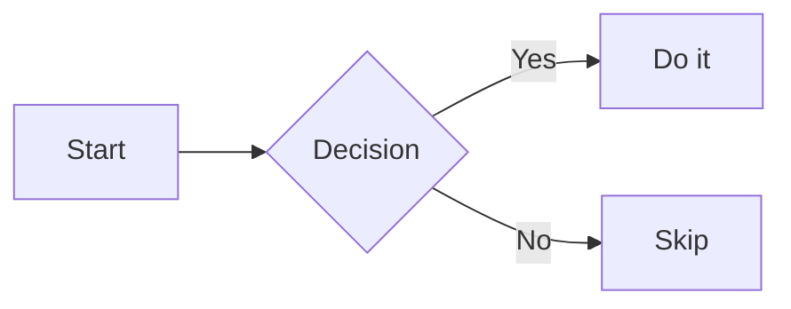

NiceGUI provides a rich set of elements for rendering text and content on the page. Whether you need plain text labels, formatted Markdown, raw HTML injection, syntax-highlighted code blocks, or decorative UI elements like icons and chips, these building blocks cover the full spectrum of content presentation.

## `ui.label`

The simplest element: renders a plain text string inside a `<div>`. Bind `.text` reactively or pass it directly.

**Constructor**

```python
ui.label(text: str = '')
```

| Parameter | Type | Default | Description |
|-----------|------|---------|-------------|
| `text` | `str` | `''` | The content to display |

**Example**

```python
from nicegui import ui

ui.label('Hello, NiceGUI!')

name = 'World'
ui.label(f'Hello, {name}!')

ui.run()
```

---

## `ui.markdown`

Renders Markdown content to HTML using `markdown2`. Supports fenced code blocks and tables by default. Optionally renders Mermaid diagrams when you add `'mermaid'` to `extras`.

**Constructor**

```python
ui.markdown(
    content: str = '',
    *,
    extras: list[str] | None = None,
    sanitize: Callable[[str], str] | bool = True,
)
```

| Parameter | Type | Default | Description |
|-----------|------|---------|-------------|
| `content` | `str` | `''` | Markdown source string |
| `extras` | `list[str] \| None` | `['fenced-code-blocks', 'tables']` | `markdown2` extensions to enable |
| `sanitize` | `bool \| Callable` | `True` | `True` = DOMPurify sanitization; `False` = none; callable = server-side |

**Example**

```python
from nicegui import ui

ui.markdown('''
# Welcome
This is **bold** and _italic_ text.

| Column A | Column B |
|----------|----------|
| 1        | 2        |
''')

ui.run()
```

<Note>
Set `sanitize=False` only for fully trusted content. For user-generated content, keep the default `True` or supply a custom sanitizer callable.
</Note>

---

## `ui.html`

Injects arbitrary HTML into the page, wrapped in the specified tag. Tailwind CSS classes can be used for styling.

**Constructor**

```python
ui.html(
    content: str = '',
    *,
    sanitize: Callable[[str], str] | bool = True,
    tag: str = 'div',
)
```

| Parameter | Type | Default | Description |
|-----------|------|---------|-------------|
| `content` | `str` | `''` | Raw HTML string |
| `sanitize` | `bool \| Callable` | `True` | Sanitization mode |
| `tag` | `str` | `'div'` | Wrapping HTML tag |

**Example**

```python
from nicegui import ui

ui.html('<strong>Bold</strong> and <em>italic</em> via raw HTML')
ui.html('<span style="color:crimson;">Styled span</span>', tag='p')

ui.run()
```

<Warning>
Pass `sanitize=False` only when the HTML is generated entirely by your own code — never for user-supplied strings.
</Warning>

---

## `ui.code`

Displays a syntax-highlighted code block. On HTTPS or localhost a copy-to-clipboard button appears automatically.

**Constructor**

```python
ui.code(
    content: str = '',
    *,
    language: str | None = 'python',
)
```

| Parameter | Type | Default | Description |
|-----------|------|---------|-------------|
| `content` | `str` | `''` | Source code to display |
| `language` | `str \| None` | `'python'` | Language for syntax highlighting |

**Example**

```python
from nicegui import ui

ui.code('''
def greet(name: str) -> str:
    return f"Hello, {name}!"

print(greet("NiceGUI"))
''', language='python')

ui.code('<h1>Hello</h1>', language='html')

ui.run()
```

---

## `ui.mermaid`

Renders [Mermaid](https://mermaid.js.org/) diagrams defined as text. Can be used as a standalone element or embedded inside `ui.markdown` by passing `'mermaid'` in the `extras` list.

**Constructor**

```python
ui.mermaid(
    content: str,
    config: dict | None = None,
    *,
    on_node_click: Handler[MermaidNodeClickEventArguments] | None = None,
)
```

| Parameter | Type | Default | Description |
|-----------|------|---------|-------------|
| `content` | `str` | — | Mermaid diagram definition |
| `config` | `dict \| None` | `None` | Config passed to `mermaid.initialize()` |
| `on_node_click` | `Handler \| None` | `None` | Callback when a node is clicked |

**Standalone example**

```python
from nicegui import ui

ui.mermaid('''
graph LR
    A[Start] --> B{Decision}
    B -->|Yes| C[Do it]
    B -->|No| D[Skip]
''')

ui.run()
```

**Via `ui.markdown` extras**

```python
from nicegui import ui

ui.markdown('''

''', extras=['mermaid', 'fenced-code-blocks'])

ui.run()
```

---

## `ui.restructured_text`

Renders reStructuredText (RST) content using `docutils`. Useful when your content source is `.rst` documentation.

**Constructor**

```python
ui.restructured_text(content: str = '')
```

| Parameter | Type | Default | Description |
|-----------|------|---------|-------------|
| `content` | `str` | `''` | The reStructuredText source string |

**Example**

```python
from nicegui import ui

ui.restructured_text('''
**Bold RST** and *italic RST*.

.. code-block:: python

   print("hello rst")
''')

ui.run()
```

---

## `ui.icon`

Renders a Material Icon using Quasar's `QIcon` component.

**Constructor**

```python
ui.icon(
    name: str,
    *,
    size: str | None = None,
    color: str | None = None,
)
```

| Parameter | Type | Default | Description |
|-----------|------|---------|-------------|
| `name` | `str` | — | Icon name in snake_case (e.g. `add_circle`) |
| `size` | `str \| None` | `None` | CSS size or named size: `xs`, `sm`, `md`, `lg`, `xl` |
| `color` | `str \| None` | `None` | Quasar, Tailwind, or CSS color |

**Example**

```python
from nicegui import ui

ui.icon('thumb_up', size='2rem', color='green')
ui.icon('warning', size='lg', color='orange')
ui.icon('home')

ui.run()
```

<Tip>
Browse all available icon names at [Google Fonts — Material Icons](https://fonts.google.com/icons?icon.set=Material+Icons).
</Tip>

---

## `ui.avatar`

A circular (or square) avatar element backed by Quasar's `QAvatar`. Accepts an icon name or an image path with the `img:` prefix.

**Constructor**

```python
ui.avatar(
    icon: str | None = None,
    *,
    color: str | None = 'primary',
    text_color: str | None = None,
    size: str | None = None,
    font_size: str | None = None,
    square: bool = False,
    rounded: bool = False,
)
```

**Example**

```python
from nicegui import ui

ui.avatar('person', color='blue', size='xl')
ui.avatar('img:https://picsum.photos/50', size='50px')
ui.avatar('star', color='yellow-9', text_color='dark', square=True)

ui.run()
```

---

## `ui.badge`

A small badge label, typically used inside other elements to show counts or status. Backed by Quasar's `QBadge`.

**Constructor**

```python
ui.badge(
    text: str = '',
    *,
    color: str | None = 'primary',
    text_color: str | None = None,
    outline: bool = False,
)
```

**Example**

```python
from nicegui import ui

with ui.button('Inbox'):
    ui.badge('3', color='red', text_color='white')

ui.badge('New', outline=True, color='green')

ui.run()
```

---

## `ui.chip`

An interactive chip element backed by Quasar's `QChip`. Chips can be clickable, selectable, and removable.

**Constructor**

```python
ui.chip(
    text: str = '',
    *,
    icon: str | None = None,
    color: str | None = 'primary',
    text_color: str | None = None,
    on_click: Handler[ClickEventArguments] | None = None,
    selectable: bool = False,
    selected: bool = False,
    on_selection_change: Handler | None = None,
    removable: bool = False,
    on_value_change: Handler | None = None,
)
```

| Parameter | Type | Default | Description |
|-----------|------|---------|-------------|
| `text` | `str` | `''` | Label text |
| `icon` | `str \| None` | `None` | Optional icon name |
| `on_click` | `Handler \| None` | `None` | Click callback; makes chip clickable |
| `selectable` | `bool` | `False` | Allow selection toggle |
| `removable` | `bool` | `False` | Show an "×" remove button |

**Example**

```python
from nicegui import ui

ui.chip('Python', icon='code', color='indigo', text_color='white')

ui.chip(
    'Click me',
    on_click=lambda: ui.notify('Chip clicked!'),
    color='teal',
    text_color='white',
)

chip = ui.chip('Removable', removable=True, color='pink-3')

ui.run()
```

---

## Complete Example

The snippet below combines several text and content elements together on a single page.

```python
from nicegui import ui

ui.label('Plain label — no formatting')

ui.markdown('## Markdown heading\nWith **bold**, _italic_, and `inline code`.')

ui.html('<blockquote>An HTML blockquote rendered directly.</blockquote>')

ui.code('''
import nicegui
print(nicegui.__version__)
''', language='python')

with ui.row(align_items='center'):
    ui.icon('local_fire_department', size='md', color='red')
    ui.label('Hot feature')
    ui.badge('NEW', color='red', text_color='white')

with ui.row():
    for lang in ['Python', 'TypeScript', 'Rust']:
        ui.chip(lang, color='blue-grey-2', text_color='dark')

ui.run()
```
